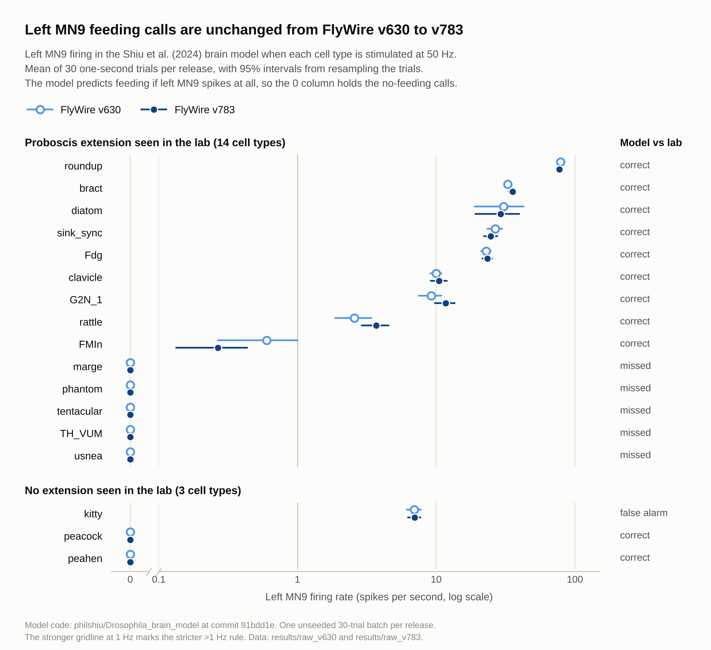

# Do revisions to a fly's brain map change which feeding responses it predicts?

I ran the Shiu et al. fruit-fly brain model on two releases of the same wiring map, FlyWire v630 and v783. Across 17 cell types, none of the primary feeding predictions changed. Both batches matched the lab observations on 11 of 17 cases, leaving the same five misses and one false positive.

Each listed input neuron received 50 Hz stimulation for 30 one-second trials per release. A positive prediction means that the left MN9 motor neuron fired at least once in the batch. The lab observation is rostrum extension, movement of one part of the fly's proboscis. The panel includes all 14 cell types that triggered this movement in the published screen, plus kitty, peacock and peahen.

## Results on v783

| Outcome against the lab observations | Cell types |
|---|---:|
| Stayed correct | 11 |
| Stayed wrong | 6 |
| Improved | 0 |
| Worsened | 0 |

Both releases detected nine of the 14 observed responses. Peacock and peahen remained correct negatives under the primary rule. TH_VUM, marge, phantom, tentacular and usnea remained misses, and kitty remained a false positive. No cell type was excluded from the comparison.

FMIn stayed positive after moving to v783: 18 left MN9 spikes in 10 of 30 trials on v630, then eight spikes in eight trials on v783. Recovering TH_VUM's changed input ID gave zero left MN9 spikes, as in the v630 rerun. Its right MN9 did respond: 78 spikes on v630 and 101 on v783, with activity in 28 trials in each batch.

The secondary marge experiment compared its surviving input alone with the full recovered pair on v783. Both conditions gave zero spikes in both MN9 readouts. This extra condition is stored as `marge_survivor_only` and is excluded from the 17-type score and figure.



[Dark version](figures/v630_vs_v783_left_mn9_dark.png) · [Spike counts and classifications](results/v783_comparison_17.csv) · [Figure script](scripts/plot_release_comparison.py)

The bars are 95% percentile bootstrap intervals for the mean rate, calculated from 10,000 resamples of the 30 trials. The plotting seed is fixed at zero; the simulations were unseeded. All ten cell types with nonzero left MN9 activity have overlapping intervals between releases. The seven types with no left MN9 spikes appear in a separate zero column. Resampling an all-zero batch always gives zero, so those points do not establish that the underlying rate is exactly zero.

In an exploratory comparison using two-sided Welch tests on the per-trial counts, the smallest unadjusted p-values were bract (0.0468), rattle (0.0560) and G2N_1 (0.0626). None passed a Bonferroni correction for the ten tested cell types: the cutoff was 0.005, and the smallest adjusted p-value was 0.468. The other seven types had zero counts in both batches and were not assigned t-test p-values. These tests were added after the simulations. Overlapping intervals and a lack of significance after correction do not establish equal firing rates or show that every difference is noise.

## How the score depends on scoring choices

Using left MN9 above 0 Hz reproduces the published screen's counts, including the five extra false positives reported at 200 Hz. I use that as the primary rule. Taking activity on either side changes the published 50 Hz score from 101 to 99 because peacock and peahen each had one right MN9 spike across 30 trials, about 0.033 Hz.

In my batches, the stricter rule of a mean left MN9 rate above 1 Hz gave the same calls on both releases and detected eight of the 14 observed responses. The either-side rule changed one call: peahen had four right MN9 spikes on v630 and none on v783, turning a false positive into a correct negative under that rule. TH_VUM was positive on both releases when either MN9 counted. These are sensitivity checks; they do not change the primary result or trigger its confirmation rule.

## Matching neurons and running the model

I used the authors' leaky integrate-and-fire model and the input lists from `sez_neurons.pickle`. The equations and default network parameters were kept the same, with 50 Hz Poisson input and 30 trials of 1 second per condition. The model code was commit `91bdd1e`, running with Python 3.13.18 and Brian2 2.11.0 in Google Colab. [Model and code](https://github.com/philshiu/Drosophila_brain_model)

The primary readout, left MN9, retains FlyWire ID 720575940660219265. The authors' right MN9 changes from 720575940645521262 to 720575940618238523. Side names follow the authors' model labels: their right MN9 is labelled left in FlyWire's annotations.

Five input neurons needed replacement IDs, one each in TH_VUM, diatom, kitty, marge and peacock. I used `fafbseg.flywire.update_ids(timestamp='mat_783')` against the public dataset and checked model membership, cell-type labels and connectivity totals. The six changed IDs, including the right MN9 readout, are recorded in [the matching table](results/id_matching_17.csv). The accepted pairs share cell-type labels and retain their model output signs. Mapping confidence measures segmentation overlap; it is not a probability that a biological identification is correct.

The recovered input sets contain 14 diatom neurons, four kitty, two marge and four peacock neurons, with no duplicate IDs within a set. TH_VUM has one recovered input. The [manifest](results/raw_v783/manifest.json) lists the exact inputs for every condition and records the model-file SHA-256 hashes. `inputs_batch1.json` contains the remaining 14 main conditions and the marge secondary condition; roundup, FMIn and TH_VUM are recorded in the manifest.

All 35 saved spike files contain records for trial IDs 0 through 29: 17 v630 files and 18 v783 files. I checked both readouts against the comparison CSV. Every listed v783 input neuron has recorded spikes. The figure script separately checks trial coverage, spike times and left MN9 counts for the 17 main conditions in both releases before plotting. The v630 batch took about two hours; most conditions took 6 to 9 minutes and diatom took about 17. Joblib printed worker-stopped warnings, so the saved files were checked before analysis.

The upstream `run_exp` has no seed argument and does not record seeds. Each release has one unseeded 30-trial batch per main condition. The notebooks retain their code and outputs as execution records. An accidental Run all after the v783 batch produced the visible "Skipping experiment" messages: existing spike files were kept, but the manifest timestamps were rewritten. Its `finished` fields now contain output-file modification times. They are reconstructed file timestamps; the original start times were not retained.

## The rule fixed before v783

The [protocol committed before the v783 runs](https://github.com/Doug826/fly-connectome-revisions/blob/16ab6406fc5d765b6346ac2f645687b82ac0df80/README.md#comparing-with-v783) specified roundup first, then FMIn, followed by the matched panel. TH_VUM was the main recovery case and marge the secondary check. My completed v630 batch was the primary baseline; the paper's values were a reference.

A changed primary call would require one fresh 30-trial batch on each release. The change would be confirmed in a second batch only if both fresh calls reproduced their respective first-batch calls. Otherwise it would be reported as unconfirmed, identifying whether v630, v783 or both failed to repeat. Each batch would be scored separately, with no pooling or further repeats to obtain a desired outcome. Since none of the 17 primary calls changed, no confirmation batches were required or run. A repeated change under that rule would establish repeatability under the protocol, not statistical significance by itself.

## Reproducing the original v630 result

My v630 rerun matched the published model's binary predictions on 16 of these 17 cell types. TH_VUM was the exception: the published batch contained one left MN9 spike, while mine contained none.

<details>
<summary>Original v630 rates, published values and trial variation</summary>

Each cell type received 50 Hz input for 30 one-second trials. The panel includes all 14 cell types that triggered rostrum extension in the lab, plus kitty, peacock and peahen. Rostrum extension is movement of one part of the proboscis, the fly's feeding tube. In the tables, "fed" refers to observed rostrum extension.

I scored a predicted response when the left MN9 motor neuron, as labelled by the authors, fired at least once across the batch. Two published true positives had mean left MN9 rates below 1 Hz. Only TH_VUM changed its any-spike prediction in my v630 rerun.

FMIn fired 18 spikes in 10 of my 30 trials. It remained positive under the any-spike rule in both datasets. With a threshold above 1 Hz, my run and the published run both detect 8 of the 14 observed responses. That threshold is a sensitivity check.

| Cell type | Real flies (fraction that fed) | Paper, left MN9 (Hz) | My run, left MN9 (Hz) | Run-to-run SD (Hz) | My run, right MN9 (Hz) | Same prediction? |
|---|---:|---:|---:|---:|---:|:---:|
| roundup | 1.0 | 79.50 | 78.77 | 7.33 | 82.27 | yes |
| diatom | 0.6 | 29.13 | 30.47 | 33.07 | 30.73 | yes |
| sink_sync | 0.2 | 22.17 | 26.67 | 9.11 | 27.60 | yes |
| G2N_1 | 1.0 | 12.37 | 9.17 | 4.78 | 9.73 | yes |
| clavicle | 0.5 | 10.50 | 10.00 | 2.62 | 6.73 | yes |
| Fdg | 0.8 | 22.53 | 22.90 | 4.91 | 20.93 | yes |
| bract | 0.8 | 33.67 | 32.60 | 4.85 | 24.23 | yes |
| rattle | 0.9 | 1.87 | 2.57 | 2.14 | 1.37 | yes |
| FMIn | 1.0 | 0.37 | 0.60 | 1.02 | 0.17 | yes |
| TH_VUM | 1.0 | 0.03 | 0.00 | 0.00 | 2.60 | **no** |
| marge | 0.1 | 0.00 | 0.00 | 0.00 | 0.00 | yes |
| phantom | 0.6 | 0.00 | 0.00 | 0.00 | 0.00 | yes |
| tentacular | 0.5 | 0.00 | 0.00 | 0.00 | 0.00 | yes |
| usnea | 1.0 | 0.00 | 0.00 | 0.00 | 0.00 | yes |
| kitty | 0.0 | 7.30 | 6.93 | 2.25 | 11.00 | yes |
| peacock | 0.0 | 0.00 | 0.00 | 0.00 | 0.03 | yes |
| peahen | 0.0 | 0.00 | 0.00 | 0.00 | 0.13 | yes |

The SD column describes variation between individual trials. Dividing it by the square root of 30, about 5.5, estimates the standard error of the batch mean under independent sampling. "Same prediction?" compares my binary call with the published call, using the unrounded spike counts.

Diatom varied widely, with a mean near 30 Hz and an SD near 33 Hz. Left MN9 fired in all 30 trials, while right MN9 fired in 12. G2N_1 averaged 9.2 Hz against the paper's 12.4, and sink_sync averaged 26.7 against 22.2. Both kept the same binary prediction. The size and cause of those rate differences need further checking.

TH_VUM's right MN9 response was 2.6 Hz. Its left-side miss therefore depends on which motor neuron is used for scoring.


</details>

## The published benchmark

Shiu and colleagues tested 106 cell types by optogenetic stimulation and compared observed rostrum extension with simulated MN9 activity. At 50 Hz model input, they reported 101 correct predictions. [Figure 2 and Supplementary Table 3](https://doi.org/10.1038/s41586-024-07763-9)

| Model prediction | Real flies fed | Real flies did not feed |
|---|---:|---:|
| Feeding | 10 | 1 |
| No feeding | 4 | 91 |

Only 14 of the 106 cell types triggered the movement. An always-negative prediction would score 92 of 106, so I also report how many responses the model detected and how many false positives it produced. In the published screen, those counts were 10 of 14 responses and one false positive.

The first notebook rebuilds these counts from all 106 rows of the paper's spreadsheet (`notebooks/01_fly_feeding_baseline.ipynb`). My panel of 17 cell types matched observed movement on 11 of 17 cases. The published model matched 12 of those same 17.


## Limitations

Both releases describe the same scanned fly. The results describe sensitivity to revisions of that reconstruction. Transfer to another animal remains an open question.

The 17-cell panel was selected to include observed responses and known problem cases. The other 89 types were negative in both the original model and lab screen. A broader claim about new false positives would require testing those cases too. These experiments cover 50 Hz stimulation.

The simulation uses predicted neurotransmitter identities to assign connection signs. Replacing the released data can change more than a neuron's identifier, so a difference between releases would need further checks before attributing it to a particular proofreading change. One batch per release also limits what can be concluded about weak responses and firing-rate differences. Zero observed spikes leave uncertainty about rare activity.

## Related work

Suifei's flywire-fly-lab reported a v783 feeding screen in commit 2dd2641 on 19 September 2026. It used three trials per condition and agreed with the published model on 100 of 101 tested cell types. FMIn was the disagreement, with 0 Hz against the paper's approximately 0.37 Hz. Its code retains only original input IDs still present in v783. It therefore excludes TH_VUM, Salivary_MN13, bamboo, gallinule and meteor, and stimulates reduced sets for partly changed types, including one marge neuron, three kitty neurons and 13 diatom neurons. [Experiment and code](https://github.com/suifei/flywire-fly-lab/commit/2dd26416f1894ac575430b16945cd4fe1973a6a9) · [Results](https://github.com/suifei/flywire-fly-lab/blob/main/results/screen/sufficiency/summary.json)

FMIn fired in 10 of my 30 v630 trials and eight of my 30 v783 trials. Selecting three distinct trials from those batches gives a zero-spike selection about 28% and 38% of the time, respectively. This supports sampling variation as a possible explanation for the earlier zero. It does not establish the cause of that result.

This project adds recovery of changed neuron IDs, 30 trials per condition, and a confirmation rule committed before my v783 results. All 17 intended input sets were recovered. No primary call changed, so the confirmation rule was not triggered.

A November 2026 preprint by Asis studies odour learning in a whole-brain model based on Shiu et al.'s. Its v783 validation drops connections with fewer than five synapses and flips the signs of 44 antennal-lobe neurons, reporting reproduction of 8 of 13 benchmark results. Those model changes need to be considered when comparing its results with the original. [Preprint](https://arxiv.org/abs/2611.09930)


## Repository contents

```text
notebooks/
  01_fly_feeding_baseline.ipynb     rebuilds the paper's 106-cell benchmark
  02_v630_reproduction.ipynb        original-map runs and comparison with the paper
  03_v783_comparison.ipynb          ID matching, v783 runs and release comparison
scripts/
  v630_batch_check.py              checks v630 raw files and scores both MN9 readouts
  plot_release_comparison.py       checks left MN9 counts and redraws both figures
figures/
  v630_vs_v783_left_mn9.png         light figure
  v630_vs_v783_left_mn9_dark.png    dark figure
results/
  fly_feeding_50hz_predictions.csv     published rates and scoring choices
  fly_feeding_input_id_inventory.csv   original-ID survival across 106 cell types
  v630_reproduction_17.csv             v630 rates against the paper
  v630_50Hz_MN9_summary.csv            independent v630 spike-count check
  id_matching_17.csv                  six changed input/readout ID mappings
  v783_comparison_17.csv              17 main comparisons plus marge_survivor_only
  raw_v630/                          17 original-map spike files
  raw_v783/
    *.parquet                        18 v783 spike files, including the marge check
    manifest.json                    inputs, file hashes, settings and provenance
    inputs_batch1.json               input lists for the final 15 conditions
```

## Reproducing the analysis

The saved files let you check the main left MN9 counts and redraw the figure without Colab or a FlyWire account. From a terminal:

```bash
git clone https://github.com/Doug826/fly-connectome-revisions.git
cd fly-connectome-revisions
python -m pip install numpy pandas pyarrow matplotlib
python scripts/plot_release_comparison.py
```

The script checks both releases against `results/v783_comparison_17.csv`, excluding `marge_survivor_only`, then writes the light and dark figures. It should report 17 checked cell types and no changed left MN9 calls. The bootstrap seed is fixed; PNG rendering can vary with Matplotlib and installed fonts. The committed figures were made with Matplotlib 3.11.2.

<details>
<summary>Repeat the exploratory firing-rate tests</summary>

Install SciPy with `python -m pip install scipy`, then run this Python code from the repository root. It uses independent, two-sided Welch tests and applies a Bonferroni correction across the ten cell types with observed left MN9 activity. The seven all-zero pairs are reported as untested.

```python
import pandas as pd
from scipy.stats import ttest_ind
from scripts.plot_release_comparison import RAW, TABLE, left_counts

table = pd.read_csv(TABLE)
names = table.loc[table.cell_type != 'marge_survivor_only', 'cell_type']
rows = []
for name in names:
    experiment = f'{name}_50Hz'
    a = left_counts(RAW['v630'] / f'{experiment}.parquet', experiment)
    b = left_counts(RAW['v783'] / f'{experiment}.parquet', experiment)
    if a.sum() + b.sum() == 0:
        print(f'{name}: all-zero pair, not tested')
        continue
    p = ttest_ind(a, b, equal_var=False, alternative='two-sided').pvalue
    rows.append({'cell_type': name, 'p_unadjusted': p})
tests = pd.DataFrame(rows).sort_values('p_unadjusted')
tests['p_bonferroni'] = (tests.p_unadjusted * len(tests)).clip(upper=1)
print(tests.to_string(index=False))
```

</details>

## Running new simulations

The notebooks are records of the Colab runs and use Drive paths. Save a working copy before running new batches. The original setup cell clones the current upstream branch, so replace it with the following cell and run it once in a fresh Colab runtime to use the recorded model revision:

```python
%cd /content
!git clone https://github.com/philshiu/Drosophila_brain_model.git
%cd /content/Drosophila_brain_model
!git checkout 91bdd1e7dcf193f3e7ca5a8933497fcef63b7960
!pip install brian2==2.11.0
```

For v630, open `notebooks/02_v630_reproduction.ipynb`, run the imports and setup, mount Drive and choose a new results folder. Run the 17-type batch and the comparison cell. Upload `scripts/v630_batch_check.py` and call `check_batch(config, params)` to write `v630_50Hz_MN9_summary.csv`. It checks both v630 readouts; its right MN9 ID is specific to that release.

For v783:

1. Open a copy of `notebooks/03_v783_comparison.ipynb`. After the pinned setup and imports, use its cells that select `Completeness_783.csv` and `Connectivity_783.parquet` and mount Drive. Set `config['path_res']` to a new, empty folder for this batch.
2. Make `results/v630_50Hz_MN9_summary.csv` available at the Drive path read by the final comparison cell, or edit that path. This is the completed v630 baseline.
3. Run the input checks, then roundup and FMIn. To recheck the ID mappings, use a FlyWire token in Colab Secrets named `FLYWIRE_TOKEN`, query `mat_783`, and record the fafbseg and annotation versions used. The matching CSV records annotation revision `a83b277`; a later annotation snapshot may differ.
4. Run the matching, evidence and TH_VUM cells, followed by the cells that save the remaining input lists and run the final batch. Check the accepted IDs against `results/id_matching_17.csv` and the manifest before running. Keep 30 one-second trials at 50 Hz for each condition, including the marge secondary check.
5. Run the final comparison cell to recount both MN9 outputs and write the comparison CSV. Skip the last timestamp-repair cell: it documents the accidental rerun of the original batch.

Run individual cells when returning to a notebook. The simulator skips an existing output file by default, but the notebook can still rewrite its manifest. Keep the completed files and manifest together, and use a separate folder for every new batch. Unseeded reruns can produce different counts or rare-spike calls. Drive retains finished files; an interrupted experiment may need to run again.

## Credits

The FlyWire Consortium reconstructed the brain. [Dorkenwald et al., Nature (2024)](https://doi.org/10.1038/s41586-024-07558-y)

Shiu and colleagues developed the model and collected the experimental comparison data. The supplementary data used here are licensed under CC BY 4.0. [A Drosophila computational brain model reveals sensorimotor processing, Nature (2024)](https://doi.org/10.1038/s41586-024-07763-9)

I reproduced the v630 benchmark, recovered changed neuron IDs and compared the two releases. I used AI assistance for planning, code, analysis and writing, including the Avoid AI Writing plugin for this README. I ran the simulations in Colab and checked the saved results against the published data.
